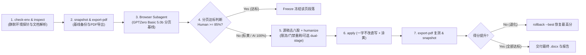

# BunnyScholar × GPTZero Humanizer Loop | Bunny学术拟人改写与GPTZero降AI率闭环工作流

[](./LICENSE)
[](#)
[](./SKILL.md)

**BunnyScholar × GPTZero Humanizer Loop** 是一个可直接开源发布、并在全球新环境中开箱即用的标准化 **Agent Skill** 与零依赖 CLI 工具集。它将“**BunnyScholar（Bunny学术）开放平台拟人改写 API + 内置浏览器 GPTZero 分页自检 + 快照回滚与 OpenXML 无损涂黄**”串联为闭环工作流（曾在实战中将 4 页英文论文从 100% AI 逆转至 4/4 页全部 `Human 99% / 98% / 97% / 87%`）。

**BunnyScholar × GPTZero Humanizer Loop** is a zero-dependency Python 3 CLI and standardized **Agent Skill** designed for an auditable, rollback-safe academic humanization loop—combining the **BunnyScholar Humanizer API**, **in-browser GPTZero page-by-page verification**, **lossless OpenXML `.docx` editing & yellow highlighting**, and **automated snapshot rollback**.

---

## 闭环架构流程 | Loop Architecture



---

## 核心亮点 | Key Highlights

- **零第三方依赖（Zero-Dependency CLI）**：`scripts/humanizer_loop.py` 100% 基于 Python 3 标准库（`zipfile`、`xml.etree.ElementTree`、`urllib`、`argparse`、`msvcrt`/`fcntl`），兼容 `python`、`python3` 与 `uv run`，新电脑无需安装 `python-docx`、`pymupdf` 或 `uv`。
- **灵活裁剪原则（Flexible by Design）**：严守 5 条不可破红线（绝不手改返回句、不泄漏 Key、不绕过人机校验、保留排版超链接、达标页冻结），其余流程高度灵活——支持纯文本轻量直调、双轨检测（局部文本框粘贴快测免上传确认弹窗 + 首尾 PDF 分页验收）、`--allow-first-person`、`--language` / `--platform` 自由切换及 `highlight_substrings` 局部涂黄。
- **OpenXML 无损手术与透明战报**：直接读写 `word/document.xml`，完整保留原有页边距、行距、字体（如 Times New Roman 12pt）、引文与 `<w:hyperlink>` 关系节点；支持 UTF-8 BOM JSON 兼容；闭环结束自动汇总整体/逐页/逐段 AI 率、顽固段复盘与双平台额度成本对账。
- **跨进程限流与智能门禁**：基于 `time.monotonic()` + 跨进程文件锁严格限流（默认 ≤ 20 req/s），支持 HTTP `429`/`5xx` 指数退避重试；自动忽略 URL 与直接引语中的误报，拦截非引语第一人称、超长乱码词或丢失 `[n]` 引文并自动重刷。

---

## 7 个标准化 CLI 子命令 | CLI Subcommands

| 子命令 (`Subcommand`) | 功能说明 (`Description`) |
| :--- | :--- |
| `check-env` | 静默探测 `BUNNYSCHOLAR_API_KEY`、PDF 后端（Word COM / `soffice`）及 `bunnyscholar-api` 前置安装 |
| `inspect` | 解析 `.docx` 正文角色（`body_para_indices`）、硬分页、黄色高亮分布、引文 `[1]..[N]` 与第一人称（自动忽略 URL/直接引语） |
| `snapshot` | 备份 `.docx` 至 `.snapshots/v{N}_{timestamp}.docx` 并记录 GPTZero 实测分数至 `history.json` |
| `rollback` | 查看快照得分对比表（`--list`），恢复指定版本（`--version`）或历史最高分（`--best`） |
| `humanize` | 限流调用 `POST /api/open/humanizer`（支持 `--dual-stage`、`--language`、`--platform`、`--allow-first-person` 等） |
| `apply` | 将 API 原文**一字不改**写入指定段落，支持 `--highlight-paras` 整段涂黄与 `highlight_substrings` 局部涂黄 |
| `export-pdf` | Windows 优先 Word COM 导出（保超链接与高亮），跨平台兜底 LibreOffice `soffice`，支持 `--stage-to` |

---

## 新环境从零配置 | Quick Setup

### 0. 前置安装 `bunnyscholar-api` | Prerequisite

在对话中先对你的 Agent 发送以下前置指令（或确认已安装）：
```text
请根据 https://bunnyscholar.cn/skills/bunnyscholar-api.md，安装 bunnyscholar-api。
```

### 1. 安装 Skill | Install the Skill

- **Google Antigravity（全局安装）**：
  ```bash
  git clone https://github.com/<your-org>/bunnyscholar-gptzero-loop.git ~/.gemini/config/skills/bunnyscholar-gptzero-loop
  ```
- **Claude Code（全局安装）**：
  ```bash
  git clone https://github.com/<your-org>/bunnyscholar-gptzero-loop.git ~/.claude/skills/bunnyscholar-gptzero-loop
  ```
- **Codex / 项目级通用（`.agents/skills/`）**：
  ```bash
  git clone https://github.com/<your-org>/bunnyscholar-gptzero-loop.git .agents/skills/bunnyscholar-gptzero-loop
  ```

### 2. 安全配置 BunnyScholar API Key | Configure API Key Safely

前往 [BunnyScholar 开发者控制台](https://bunnyscholar.cn/developer) 创建 `sk-xxxx` 密钥后，使用**无回显终端命令**写入 `~/.env`（切勿在聊天窗口粘贴明文 Key）：

- **Windows PowerShell**：
  ```powershell
  $k = Read-Host -Prompt "Enter BUNNYSCHOLAR_API_KEY (typing hidden)" -AsSecureString; $plain = [Runtime.InteropServices.Marshal]::PtrToStringAuto([Runtime.InteropServices.Marshal]::SecureStringToBSTR($k)); Add-Content -Path "$HOME\.env" -Value "BUNNYSCHOLAR_API_KEY=$plain"; Remove-Variable k, plain; Write-Output "Saved."
  ```
- **macOS / Linux Bash**：
  ```bash
  read -rsp "Enter BUNNYSCHOLAR_API_KEY (typing hidden): " k && echo "" && printf 'BUNNYSCHOLAR_API_KEY=%s\n' "$k" >> ~/.env && unset k && echo "Saved."
  ```

### 3. 验证环境 | Verify Environment

```bash
python scripts/humanizer_loop.py check-env --output env_status.json
```

---

## 开源协议与隐私声明 | License & Privacy

- 本项目基于 [MIT License](./LICENSE) 开源发布。
- `.gitignore` 已默认忽略 `.env`、`.env.*`、`.snapshots/`、`*.docx`、`*.pdf`、`*_log.json` 与 `__pycache__/`，确保用户个人论文文档与 API 密钥绝不会被意外提交至远程仓库。
