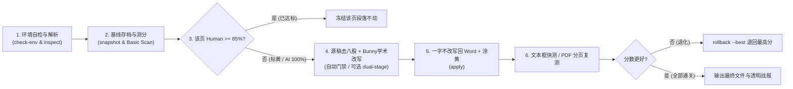

<a id="top"></a>

<div align="center">

# BunnyScholar × GPTZero Humanizer Loop

### Bunny学术拟人改写 × GPTZero 论文降 AI 率闭环助手

[](./LICENSE)
[](#)
[](#)
[](./SKILL.md)
[](https://github.com/Whitopus/bunnyscholar-gptzero-loop)

**跳转导航：**
[简体中文](#简体中文) ·
[English](#english) ·
[📚 入口速达](#quick-links) ·
[🚀 3步上手](#quick-start) ·
[💬 第一句话怎么说](#first-prompt) ·
[🧰 工具箱](#cli-tools)

</div>

---

<a id="简体中文"></a>

## 简体中文

### 这是什么？

写英文或中文学术论文时，降 AI 率最怕“抽盲盒”：改完一段去网页测，结果原来过关的页面又红了；好不容易降下来，自己顺手改了一个标点，AI 率瞬间反弹；或者改完后 Word 的字体、行距、超链接全乱了。

**BunnyScholar × GPTZero Humanizer Loop** 是一套开箱即用的标准化 **Agent Skill**。它把 **Bunny学术（BunnyScholar）拟人改写接口**、**内置浏览器 GPTZero 免费实测**、**Word 无损改写与涂黄** 以及 **自动存档回滚** 串成一条闭环（曾在真实 4 页英文作业中，将全篇 `100% AI` 一路压到 4 页全绿 **`Human 99% / 98% / 97% / 87%`**）：

- **过关的页锁死不动**：测完基线后，`Human >= 85%` 或纯白页面直接冻结，只改标黄的页面和段落。
- **改差了一键退回**：每次动手前自动备份 `.docx`，分数不升反降就一键恢复历史最高分版本。
- **原排版纹丝不动**：直接修改 Word 底层 XML，Times New Roman 12pt、页边距、行距和可点击超链接原封不动，还能按作业要求对指定段落或局部短语精准涂黄。
- **不装任何第三方库**：脚本 100% 用 Python 3 自带标准库写成，新电脑无需安装 `uv`、`python-docx` 或 `pymupdf`。

<a id="quick-links"></a>

### 📚 文档与官方入口速达

| 分类 | 入口 | 说明 |
| :--- | :--- | :--- |
| **核心规范** | [SKILL.md](./SKILL.md) | Agent Skill 主规范（5 条硬红线、灵活策略与战报模板） |
| **新手引导** | [onboarding_guide.md](./references/onboarding_guide.md) | 零基础冷启动、无回显 Key 录入、缺 PDF 后端与充值引导 |
| **浏览器 SOP** | [gptzero_browser_sop.md](./references/gptzero_browser_sop.md) | GPTZero 双轨快测、3 连广告弹窗清理与人机校验边界 |
| **降 AI 手册** | [anti_ai_playbook.md](./references/anti_ai_playbook.md) | 分页冻结、先一后二、顽固 `AI 100%` 页三步破局实战 |
| **零依赖脚本** | [humanizer_loop.py](./scripts/humanizer_loop.py) | 100% Python 3 标准库 CLI 工具源码 |
| **官方服务** | [BunnyScholar 控制台](https://bunnyscholar.cn/developer) · [bunnyscholar-api.md](https://bunnyscholar.cn/skills/bunnyscholar-api.md) · [GPTZero](https://app.gptzero.me) | 领额建 Key、前置技能规范与 AI 检测官网入口 |

### 为什么比手动改更省心？

| 常见痛点 | 使用本 Skill 后的做法 |
| :--- | :--- |
| **手改一两句就反弹** | 接口返回文本**一字不改**直写回 Word；发现语义不对只改源稿或重刷，绝不手改成品 |
| **传文件总弹确认、烧额度** | **双轨检测**：单段迭代走首页文本框快测（免上传弹窗、极省 credits）；仅首尾才传 PDF 看分页 |
| **GPTZero 广告弹窗烦人** | 自动连环关掉 3 层试用/折扣/插件广告弹窗并切回免费 `Basic Scan (Model 5.0b)`，不打扰用户 |
| **改完不知道花了多少** | 每轮实时报扣费，结束时自动汇总**透明战报**（整体/每页 AI 率、顽固段复盘、双平台花费） |
| **担心泄漏论文或密钥** | `.gitignore` 默认屏蔽 `.env` 与所有 `.docx`/`.pdf`；探针绝不读明文 Key；绝不绕过人机验证 |

### 闭环怎么跑？



<a id="quick-start"></a>

### 🚀 3 步快速上手

#### 第 1 步：前置安装 `bunnyscholar-api`
在对话中先给你的 AI 助手发一句：
```text
请根据 https://bunnyscholar.cn/skills/bunnyscholar-api.md，安装 bunnyscholar-api。
```

#### 第 2 步：安装本 Skill

<details>
<summary>点击展开 Google Antigravity / Claude Code / Codex 安装命令</summary>

- **Google Antigravity（全局安装）**：
  ```bash
  git clone https://github.com/Whitopus/bunnyscholar-gptzero-loop.git ~/.gemini/config/skills/bunnyscholar-gptzero-loop
  ```
- **Claude Code（全局安装）**：
  ```bash
  git clone https://github.com/Whitopus/bunnyscholar-gptzero-loop.git ~/.claude/skills/bunnyscholar-gptzero-loop
  ```
- **Codex / 通用项目级（`.agents/skills/`）**：
  ```bash
  git clone https://github.com/Whitopus/bunnyscholar-gptzero-loop.git .agents/skills/bunnyscholar-gptzero-loop
  ```

</details>

#### 第 3 步：安全配置 BunnyScholar API Key
前往 [BunnyScholar 开发者控制台](https://bunnyscholar.cn/developer) 领额并创建 `sk-xxxx` 密钥，在本地终端执行以下**无回显命令**写入 `~/.env`（切勿在聊天框粘贴明文 Key）：

> [!TIP]
> 在终端里输入或粘贴密钥时，屏幕**不会显示任何字符或星号**，这是正常的安全隐藏机制，粘贴后直接按 `Enter` 即可。

- **Windows PowerShell**：
  ```powershell
  $s = Read-Host -Prompt "Enter BUNNYSCHOLAR_API_KEY (typing hidden)" -AsSecureString; $b = [Runtime.InteropServices.Marshal]::SecureStringToBSTR($s); try { $v = [Runtime.InteropServices.Marshal]::PtrToStringAuto($b); $p = Join-Path $HOME ".env"; $enc = [System.Text.UTF8Encoding]::new($false); $pre = if ((Test-Path $p) -and ([System.IO.File]::ReadAllText($p) -notmatch "(\r?\n)$")) { "`n" } else { "" }; [System.IO.File]::AppendAllText($p, "${pre}BUNNYSCHOLAR_API_KEY=$v`n", $enc); Write-Host "Saved to $p" } finally { [Runtime.InteropServices.Marshal]::ZeroFreeBSTR($b) }
  ```
- **macOS / Linux Bash**：
  ```bash
  read -rsp "Enter BUNNYSCHOLAR_API_KEY (typing hidden): " k && echo "" && printf 'BUNNYSCHOLAR_API_KEY=%s\n' "$k" >> ~/.env && unset k && echo "Saved."
  ```

运行环境自检确认就绪（在论文目录运行时请使用 Skill 目录下的脚本绝对路径；macOS/Linux 可使用 `python3`；即使无 Word/LibreOffice 也可走纯文本框快测）：
```bash
python scripts/humanizer_loop.py check-env --output env_status.json
```

<a id="first-prompt"></a>

### 💬 装完后，第一句话怎么对 AI 助手说？

直接复制下面任意一句发给你的 AI 助手即可开跑：
- **整篇 Word 闭环降 AI**：`用 bunnyscholar-gptzero-loop 帮我把这篇论文降到 GPTZero 每页 AI 率低于 15%，先检查环境再开始。`
- **配合已有报告精确涂黄**：`这是我的 GPTZero 检测截图，用 bunnyscholar-gptzero-loop 只改标黄的段落，保留原有排版并把修订处涂黄。`
- **纯文本快速降 AI**：`用 bunnyscholar-gptzero-loop 帮我把下面这两段英文降一下 GPTZero AI 率，不要改掉我的专业术语。`

<a id="cli-tools"></a>

### 🧰 内置工具箱（按需调用，不绑死 AI 助手）

| 子命令 | 作用 |
| :--- | :--- |
| `check-env` | 静默检查 `BUNNYSCHOLAR_API_KEY`、PDF 导出后端（Word COM / `soffice`）及前置技能 |
| `inspect` | 解析 `.docx` 正文段号（自动区分页眉与正文）、字数、高亮、引文与非引语第一人称 |
| `snapshot` | 备份 `.docx` 到 `.snapshots/`，并记录对应版本的 GPTZero 实测得分 |
| `rollback` | 查看历史版本得分对比表（`--list`），一键回滚指定版本（`--version`）或最高分（`--best`） |
| `humanize` | 跨进程限流调用 Bunny学术拟人接口（支持 `--dual-stage`、`--language`、`--platform`、`--allow-first-person`） |
| `apply` | 将接口返回原文**一字不改**写回 Word，支持整段涂黄（`--highlight-paras`）与局部短语涂黄（`highlight_substrings`） |
| `export-pdf` | Windows 优先 Word COM 导出（完整保留超链接与黄色高亮），其他系统自动兜底 LibreOffice |

<details>
<summary>点击查看项目目录结构</summary>

```text
bunnyscholar-gptzero-loop/
├── SKILL.md                        # Agent Skill 主规范（核心红线、灵活策略与战报模板）
├── README.md                       # 中英双语说明文档
├── LICENSE                         # MIT 开源协议
├── .gitignore                      # 严格屏蔽 .env、.docx、.pdf、.snapshots 与日志
├── .env.example                    # 密钥配置模板（不含真实密钥）
├── scripts/
│   └── humanizer_loop.py           # 100% Python 3 标准库零依赖 CLI
└── references/
    ├── onboarding_guide.md         # 新环境冷启动与无回显 Key 录入指南
    ├── gptzero_browser_sop.md      # GPTZero 双轨快测、广告弹窗清理与人机校验边界 SOP
    └── anti_ai_playbook.md         # 分页冻结、先一后二与顽固页破局实战手册
```

</details>

---

<a id="english"></a>

## English

### What It Does

Lowering AI-detection scores on academic papers often turns into a frustrating guessing game: fixing one page breaks another, tweaking a single punctuation mark triggers a false positive, and editing Word files by hand ruins fonts, margins, or clickable hyperlinks.

**BunnyScholar × GPTZero Humanizer Loop** is a zero-dependency, ready-to-use **Agent Skill** that connects **BunnyScholar's Humanizer API**, **in-browser GPTZero verification**, **lossless OpenXML `.docx` editing**, and **automatic snapshot rollback**. In real-world coursework, this workflow turned a 4-page `100% AI` draft into **`99% / 98% / 97% / 87% Human`** across all four pages.

- **Page-by-Page Freeze**: Pages scoring `Human >= 85%` (or clean white) are locked untouched; only flagged sections are iterated.
- **Instant Rollback**: Every edit snapshots the `.docx` first—if a round scores worse, roll back to the historical best with one command.
- **Lossless Word Formatting**: Directly edits `word/document.xml` using Python's stdlib (`zipfile` + `xml.etree.ElementTree`), keeping fonts, spacing, margins, and `<w:hyperlink>` nodes intact while supporting paragraph-level or phrase-level yellow highlighting.
- **Zero Third-Party Dependencies**: Runs out of the box with standard Python 3—no `uv`, `python-docx`, or `pymupdf` required.

### Why Use It

- **No Accidental Post-Edits**: Writes API outputs back verbatim without LLM paraphrasing, preventing sudden AI-score spikes.
- **Dual-Track Scanning**: Uses homepage paste-scanning for fast single-paragraph checks (no repeated file-upload prompts, minimal credit burn) and reserves full PDF uploads for baseline and final page-by-page verification.
- **Auto-Dismisses Promo Modals**: Automatically closes GPTZero's multi-step upgrade/extension popups and switches to free `Basic Scan (Model 5.0b)`.
- **Transparent Final Report**: Reports per-round cost and summarizes overall/page/paragraph score changes, stubborn-paragraph retries, GPTZero credits used, and exact BunnyScholar API cost.
- **Privacy First**: `.gitignore` blocks `.env`, `.docx`, `.pdf`, and `.snapshots/`; never echoes API keys or bypasses CAPTCHAs.

### Quick Start

1. **Install Prerequisite (`bunnyscholar-api`)**:
   Ask your AI agent:
   ```text
   Please install bunnyscholar-api according to https://bunnyscholar.cn/skills/bunnyscholar-api.md.
   ```
2. **Clone into Your Agent's Skills Directory**:
   ```bash
   # Google Antigravity
   git clone https://github.com/Whitopus/bunnyscholar-gptzero-loop.git ~/.gemini/config/skills/bunnyscholar-gptzero-loop
   ```
3. **Save Your API Key Safely** (get a key at `https://bunnyscholar.cn/developer`, never paste it in chat; hidden typing shows nothing—just paste and press `Enter`):
   ```bash
   # macOS / Linux Bash
   read -rsp "Enter BUNNYSCHOLAR_API_KEY (typing hidden): " k && echo "" && printf 'BUNNYSCHOLAR_API_KEY=%s\n' "$k" >> ~/.env && unset k && echo "Saved."
   ```
   Verify your setup:
   ```bash
   python scripts/humanizer_loop.py check-env --output env_status.json
   ```

---

## License

Released under the [MIT License](./LICENSE).

<div align="right">

[⬆️ 返回顶部 | Back to Top](#top)

</div>
