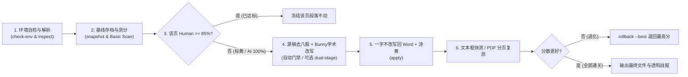

<a id="top"></a>
<div align="center">

[简体中文](#简体中文) · [English](#english)

# BunnyScholar × GPTZero Loop

用 BunnyScholar 改写指定段落，按需复核 GPTZero 报告，把选定的改动写回 Word。

[](LICENSE)
[](#quick-start)
[](SKILL.md)

[快速开始](#quick-start) · [第一句怎么说](#first-prompt) · [命令行用法](#cli-tools) · [排错](#troubleshooting)

</div>

<a id="简体中文"></a>

## 简体中文

### 这是什么？

写英文或中文学术论文时，降 AI 率最怕“抽盲盒”：改完一段去网页测，结果原来过关的页面又红了；好不容易降下来，自己顺手改了一个标点，AI 率瞬间反弹；或者改完后 Word 的字体、行距、超链接全乱了。

**BunnyScholar × GPTZero Humanizer Loop** 是一套开箱即用的标准化 **Agent Skill**。它把 **Bunny学术（BunnyScholar）拟人改写接口**、**内置浏览器 GPTZero 免费实测**、**Word 无损改写与涂黄** 以及 **自动存档回滚** 串成一条闭环（曾在真实 4 页英文作业中，将全篇 `100% AI` 一路压到 4 页全绿 **`Human 99% / 98% / 97% / 87%`**）：

- **过关的页锁死不动**：测完基线后，`Human >= 85%` 或纯白页面直接冻结，只改标黄的页面和段落。
- **改差了一键退回**：每次动手前自动备份 `.docx`，分数不升反降就一键恢复历史最高分版本。
- **原排版纹丝不动**：直接修改 Word 底层 XML，Times New Roman 12pt、页边距、行距和可点击超链接原封不动，还能按作业要求对指定段落或局部短语精准涂黄。
- **不装任何第三方库**：脚本 100% 用 Python 3 自带标准库写成，新电脑无需安装 `uv`、`python-docx` 或 `pymupdf`。

<a id="quick-links"></a>

### 📚 文档与官方入口速达

| 分类 | 入口 | 说明 |
| :--- | :--- | :--- |
| **核心规范** | [SKILL.md](./SKILL.md) | Agent Skill 主规范（5 条硬红线、灵活策略与战报模板） |
| **新手引导** | [onboarding_guide.md](./references/onboarding_guide.md) | 零基础冷启动、无回显 Key 录入、缺 PDF 后端与充值引导 |
| **浏览器 SOP** | [gptzero_browser_sop.md](./references/gptzero_browser_sop.md) | GPTZero 双轨快测、3 连广告弹窗清理与人机校验边界 |
| **降 AI 手册** | [anti_ai_playbook.md](./references/anti_ai_playbook.md) | 分页冻结、先一后二、顽固 `AI 100%` 页三步破局实战 |
| **零依赖脚本** | [humanizer_loop.py](./scripts/humanizer_loop.py) | 100% Python 3 标准库 CLI 工具源码 |
| **官方服务** | [BunnyScholar 控制台](https://bunnyscholar.cn/developer) · [bunnyscholar-api.md](https://bunnyscholar.cn/skills/bunnyscholar-api.md) · [GPTZero](https://app.gptzero.me) | 领额建 Key、前置技能规范与 AI 检测官网入口 |

### 为什么比手动改更省心？

| 常见痛点 | 使用本 Skill 后的做法 |
| :--- | :--- |
| **手改一两句就反弹** | 接口返回文本**一字不改**直写回 Word；发现语义不对只改源稿或重刷，绝不手改成品 |
| **传文件总弹确认、烧额度** | **双轨检测**：单段迭代走首页文本框快测（免上传弹窗、极省 credits）；仅首尾才传 PDF 看分页 |
| **GPTZero 广告弹窗烦人** | 自动连环关掉 3 层试用/折扣/插件广告弹窗并切回免费 `Basic Scan (Model 5.0b)`，不打扰用户 |
| **改完不知道花了多少** | 每轮实时报扣费，结束时自动汇总**透明战报**（整体/每页 AI 率、顽固段复盘、双平台花费），**并可一键 `Export` 附上最终版 GPTZero 原生 PDF 检测报告** |
| **担心泄漏论文或密钥** | `.gitignore` 默认屏蔽 `.env` 与所有 `.docx`/`.pdf`；探针绝不读明文 Key；绝不绕过人机验证 |

### 闭环怎么跑？



<a id="quick-start"></a>

### 快速开始

**第一次用 BunnyScholar？先登录。** 打开官网并点「登录」，按提示用微信扫一扫。如果弹出会员推广，点「暂不开通」。之后到「开放平台 → API Keys」创建并复制密钥。已经配过 Key 的用户可直接进入安装与自检。 [BunnyScholar 官网](https://bunnyscholar.cn/) · [密钥管理](https://bunnyscholar.cn/developer/keys)

**最省事的安装方式**是把这句话发给支持本地 Skills 的 Agent。

```text
请安装 https://github.com/Whitopus/bunnyscholar-gptzero-loop 到当前客户端的 Skills 目录，然后运行快速自检。优先复用我已有的 Key。如果缺 Key，请先打开 BunnyScholar 官网引导我登录，再告诉我去哪创建 Key，并给我一条带完整脚本路径的配置命令。
```

<details>
<summary>我想手动安装</summary>

选择当前客户端对应的一行。在 PowerShell、Bash 或 Zsh 中执行。

```sh
# Codex，当前用户
git clone https://github.com/Whitopus/bunnyscholar-gptzero-loop.git "$HOME/.agents/skills/bunnyscholar-gptzero-loop"
# Claude Code，当前用户
git clone https://github.com/Whitopus/bunnyscholar-gptzero-loop.git "$HOME/.claude/skills/bunnyscholar-gptzero-loop"
# Google Antigravity，当前用户
git clone https://github.com/Whitopus/bunnyscholar-gptzero-loop.git "$HOME/.gemini/config/skills/bunnyscholar-gptzero-loop"
```

Codex 只装到当前项目时，从项目根目录将仓库克隆到 `.agents/skills/bunnyscholar-gptzero-loop`。没有 Git 也可以下载 ZIP 并解压到对应目录，确认该目录直接包含 `SKILL.md` 和 `scripts/`。新安装后若当前会话没识别到，重新打开会话。 [下载 ZIP](https://github.com/Whitopus/bunnyscholar-gptzero-loop/archive/refs/heads/main.zip)

进入刚才安装的 Skill 目录后运行：

```sh
python scripts/humanizer_loop.py check-env --quick --summary
```

如果 `python` 不可用，Windows 试 `py -3`，macOS / Linux 试 `python3`。CLI 只使用 Python 标准库。从论文目录运行时，改用带引号的脚本绝对路径。

</details>

**配置只需一条命令。** 在 Skill 目录中的本地终端运行 `python scripts/humanizer_loop.py setup-key`。已有 Key 会自动复用。缺 Key 时，按提示粘贴后直接回车，输入区空白是正常的。脚本保存后会读回确认。想主动换 Key 时加 `--replace`。 [详细配置与排错](references/onboarding_guide.md)

`bunnyscholar-api` 可以选装。Agent 也可直接打开官方接口说明。改写请求会发送文本到 BunnyScholar 并按服务计费，快捷自检和 `--dry-run` 在本地运行。 [官方 API 说明](https://bunnyscholar.cn/skills/bunnyscholar-api.md) · [价格](https://bunnyscholar.cn/developer/pricing)

**第一次付费改写前**，可以先看「用量信息」里的可用赠额和余额。够用就继续。要改整篇时，可以先用 `--dry-run` 估算用量，再按需充值。 [查看用量与余额](https://bunnyscholar.cn/developer) · [充值](https://bunnyscholar.cn/developer/recharge)

<a id="first-prompt"></a>

### 第一句怎么说

- **一段英文**。`用 bunnyscholar-gptzero-loop 改下面这段英文，目标 GPTZero，保留术语和引文。先给我候选文本。`
- **已有报告**。`这是我的 GPTZero 截图。按标记定位 Word 正文，只改第 2 页对应的两段，另存 Word 并标黄。`
- **整篇 Word**。`请保留原稿，先用已有报告选段。改完给我 Word 副本，只在最后用 PDF 做一次分页复测。`

<a id="cli-tools"></a>

### 命令行用法

将一段文字保存成 UTF‑8 的 `paragraph.txt`。本地预检会给出估算计费字符数。确认后可执行第二条，结果保存在 JSON 的 `paragraphs[0].text`。

```sh
python scripts/humanizer_loop.py humanize --text-file paragraph.txt --dry-run
python scripts/humanizer_loop.py humanize --text-file paragraph.txt --output result.json --allow-quality-warnings
```

默认按英文 GPTZero 处理。中文知网示例在上述命令追加 `--language zh_CN --platform cnki`。一份文本文件会作为单次请求发送。多段或需要对应 Word 段号时，改用 `--input paragraphs.json`。质量检查默认评估一次结果，额外改写用 `--max-retries N` 显式开启，可能继续计费。 [JSON 示例与 Word 操作](references/anti_ai_playbook.md)

| 命令 | 何时用 |
| --- | --- |
| `check-env --quick --summary` | 查看 Python、Key 来源和本地 API 说明。Agent 可省去 `--summary` 读取 JSON。 |
| `setup-key` | 自动复用已有 Key，或在本地终端无回显录入并验证保存结果。默认写入 `~/.env`。 |
| `inspect --docx paper.docx` | 找正文段号、引文、高亮与硬分页。 |
| `apply --docx paper.docx --humanized result.json --output-docx paper.revised.docx` | 按匹配的段号写入选定结果，另存副本。复杂行内样式、链接和分页可打开文件核对。 |
| `snapshot --docx paper.docx` / `rollback --docx paper.docx --list` | 多轮修订时存档、查看或恢复版本。 |
| `export-pdf --docx paper.revised.docx` | 用 Windows Word 或 LibreOffice 导出 PDF。 |
| `self-update` / `self-update --apply` | 检查版本、应用更新。Git 安装也可在 Skill 目录执行 `git pull --ff-only`。 |

<a id="quick-links"></a>
<a id="troubleshooting"></a>

### 排错与参考

- **密钥已配置，服务仍报错**。自检只看本地来源，`401` / `403` 时可核对密钥来源和控制台状态，`402` 时检查余额。 [配置与排错](references/onboarding_guide.md)
- **找不到分页视图或需要登录**。视图和额度随账号与界面而变。登录或人机验证出现时，可以接手当前浏览器。已有报告可继续用于定位。 [浏览器操作参考](references/gptzero_browser_sop.md)
- **没装 Word / LibreOffice**。纯文本改写、读取报告和 Word 段落修改都能用。只有从 DOCX 导出 PDF 才需要导出工具。 [Word 段落修订与复测](references/anti_ai_playbook.md)
- 想查看 Agent 如何选择流程，见 [SKILL.md](SKILL.md)。

---

<a id="english"></a>

## English

BunnyScholar × GPTZero Loop is an Agent Skill for rewriting selected text with BunnyScholar, reviewing GPTZero results when requested, and applying selected changes to Word. The CLI uses only the Python 3.8+ standard library.

### Get started

**New to BunnyScholar? Sign in first.** Open the homepage, select Log in, and follow the WeChat QR prompt. Dismiss the membership prompt if it appears, then open the developer console and select API Keys. If you already have a configured key, go straight to installing the Skill. The [manual clone commands above](#quick-start) cover Codex, Claude Code, and Google Antigravity. [BunnyScholar homepage](https://bunnyscholar.cn/) · [Manage API keys](https://bunnyscholar.cn/developer/keys)

```text
Install https://github.com/Whitopus/bunnyscholar-gptzero-loop as a Skill and check my setup. Reuse any configured key. If it's missing, open BunnyScholar's sign-in entry, show me where to create a key, and give me the setup command with the full script path.
```

From the installed Skill folder, run:

- **No Accidental Post-Edits**: Writes API outputs back verbatim without LLM paraphrasing, preventing sudden AI-score spikes.
- **Dual-Track Scanning**: Uses homepage paste-scanning for fast single-paragraph checks (no repeated file-upload prompts, minimal credit burn) and reserves full PDF uploads for baseline and final page-by-page verification.
- **Auto-Dismisses Promo Modals**: Automatically closes GPTZero's multi-step upgrade/extension popups and switches to free `Basic Scan (Model 5.0b)`.
- **Transparent Final Report**: Reports per-round cost, summarizes overall/page/paragraph score changes, stubborn-paragraph retries, GPTZero credits used, and exact BunnyScholar API cost, and can attach the native GPTZero PDF report via `Export`.
- **Privacy First**: `.gitignore` blocks `.env`, `.docx`, `.pdf`, and `.snapshots/`; never echoes API keys or bypasses CAPTCHAs.

Use `py -3` on Windows or `python3` on macOS/Linux if needed. Run `python scripts/humanizer_loop.py setup-key` in your own terminal to reuse a configured key or enter one at the hidden prompt. The command saves to `~/.env` by default and verifies the saved file. Use `--replace` to enter a new key. [Manage keys](https://bunnyscholar.cn/developer/keys) · [Official API reference](https://bunnyscholar.cn/skills/bunnyscholar-api.md)

Before your first paid rewrite, check your available credits and balance. Top up if needed. [Usage and balance](https://bunnyscholar.cn/developer) · [Top up](https://bunnyscholar.cn/developer/recharge)

### Try one paragraph

Save a paragraph as UTF‑8 in `paragraph.txt`, then run a local length check. The second command sends the paragraph to BunnyScholar, which can incur a charge. Read the candidate in `paragraphs[0].text` in `result.json`.

```sh
python scripts/humanizer_loop.py humanize --text-file paragraph.txt --dry-run
python scripts/humanizer_loop.py humanize --text-file paragraph.txt --output result.json --allow-quality-warnings
```

English/GPTZero are the CLI defaults. For Word, use `inspect` to find the paragraph IDs and `apply --output-docx` to save a revised copy. An existing GPTZero report can guide paragraph selection. A PDF export tool and browser matter only if your requested workflow uses them. Check the [CLI commands](#cli-tools) or run `python scripts/humanizer_loop.py --help`.

To update, run `self-update` to check the remote version and `self-update --apply` to install it. For a Git checkout, `git pull --ff-only` in the Skill folder also works.

## License

[MIT](LICENSE) · [Back to top](#top)
